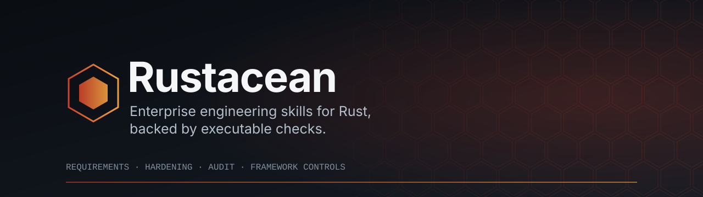

<div align="center">



<br>

[](https://github.com/jelome265/Rustacean/actions/workflows/ci.yml)
[](https://github.com/jelome265/Rustacean/actions/workflows/codeql.yml)
[](https://github.com/jelome265/Rustacean/actions/workflows/security.yml)
[](https://github.com/jelome265/Rustacean/actions/workflows/scorecard.yml)
[](LICENSE)


**[Quick install](#quick-install)** · **[Platforms](#install-on-each-platform)** · **[Verify](#verify-discovery)** · **[What's included](#whats-included)** · **[Local checks](#local-verification)** · **[Docs](#documentation)**

</div>

---

## Quick install

### Option A: Claude Code plugin (recommended for Claude Code)

Requires a Claude Code version with the `claude plugin` commands (tested with 2.1.299). Run these in your shell:

```bash
claude plugin marketplace add jelome265/Rustacean
claude plugin install rustacean@rustacean
```

Verify with `claude plugin details rustacean`. The output should list five skills. Updates arrive when the plugin `version` changes.

Use `claude plugin marketplace add /path/to/local/Rustacean` to install from a clone instead.

### Option B: Installer for any supported agent

Rustacean installs five cooperating agent skills into the discovery directory of your coding agent. Requirements: **Git** and **Python 3**.

```bash
git clone https://github.com/jelome265/Rustacean.git
cd Rustacean

# 1. Dry run: prints the plan, writes nothing
python3 tools/install_skills.py --agent codex --project-root /path/to/your/project

# 2. Apply and verify
python3 tools/install_skills.py --agent codex --project-root /path/to/your/project --apply
```

Replace `codex` with your agent's ID from the [platform table](#install-on-each-platform). Every run:

- validates the source suite before touching anything,
- computes the full plan before writing, so a partial suite is never left behind,
- after writing, compares each installed skill to the source by content hash and checks that every peer link resolves.

Exit codes: `0` success or dry run, `1` refused or verification failed, `2` usage error.

### Alternative: npx (no clone required)

Requires **Node.js 18+** and **Python 3**. The package bundles the installer and the five skills:

```bash
npx rustacean-skills --list
npx rustacean-skills --agent codex --project-root /path/to/your/project           # dry run
npx rustacean-skills --agent codex --project-root /path/to/your/project --apply   # install and verify
```

Every option in the installer applies. The launcher only locates Python 3 and forwards arguments and the exit code. Set `RUSTACEAN_PYTHON=/path/to/python3` to choose an interpreter.

---

## Install on each platform

List the supported agents and their documentation grade at any time:

```bash
python3 tools/install_skills.py --list
```

### Platform table

Project scope is the default. Use `--scope user` for every project on the machine.

| Agent | `--agent` | Project location | User location | Path evidence |
|---|---|---|---|---|
| Claude Code | `claude-code` | `.claude/skills/` | `~/.claude/skills/` | Official |
| OpenAI Codex CLI | `codex` | `.agents/skills/` | `~/.agents/skills/` | Official, sources disagree on user path |
| OpenCode | `opencode` | `.agents/skills/` | `~/.agents/skills/` | Official |
| Gemini CLI | `gemini-cli` | `.agents/skills/` | `~/.agents/skills/` | Official |
| Zed Agent | `zed` | `.agents/skills/` | `~/.agents/skills/` | Official |
| Google Antigravity | `antigravity` | `.agents/skills/` | `~/.gemini/config/skills/` | Official, CLI differs |
| Cursor | `cursor` | `.agents/skills/` | `~/.agents/skills/` | Official |
| GitHub Copilot (VS Code) | `copilot` | `.agents/skills/` | `~/.agents/skills/` | Official |
| Z.AI ZCode | `zcode` | `.zcode/skills/` | `~/.zcode/skills/` | Conflicting, requires `--accept-conflicting` |
| Freebuff (Codebuff) | `freebuff` | `.agents/skills/` | `~/.agents/skills/` | Third-party, not runtime-verified |
| Meta Muse Code | `muse` | `.agents/skills/` | `~/.agents/skills/` | Third-party, not runtime-verified |
| Kimi Code CLI | `kimi` | `.agents/skills/` | `~/.agents/skills/` | Conflicting, requires `--accept-conflicting` |

Evidence grades describe the quality of the vendor documentation for the path. They are not a test that the agent loads the skills.

### Commands

Run each block from the Rustacean clone. Add `--apply` to write files after reviewing the dry run.

```bash
PROJECT=/absolute/path/to/your/project

# Claude Code
python3 tools/install_skills.py --agent claude-code --project-root "$PROJECT" --apply

# OpenAI Codex CLI
python3 tools/install_skills.py --agent codex --project-root "$PROJECT" --apply

# OpenCode
python3 tools/install_skills.py --agent opencode --project-root "$PROJECT" --apply

# Gemini CLI
python3 tools/install_skills.py --agent gemini-cli --project-root "$PROJECT" --apply

# Zed Agent
python3 tools/install_skills.py --agent zed --project-root "$PROJECT" --apply

# Google Antigravity (app / IDE)
python3 tools/install_skills.py --agent antigravity --project-root "$PROJECT" --apply

# Cursor
python3 tools/install_skills.py --agent cursor --project-root "$PROJECT" --apply

# GitHub Copilot (VS Code agent)
python3 tools/install_skills.py --agent copilot --project-root "$PROJECT" --apply

# Z.AI ZCode (documentation conflicts; confirm discovery on your installed version)
python3 tools/install_skills.py --agent zcode --project-root "$PROJECT" --accept-conflicting --apply

# Freebuff (Codebuff)
python3 tools/install_skills.py --agent freebuff --project-root "$PROJECT" --apply

# Meta Muse Code
python3 tools/install_skills.py --agent muse --project-root "$PROJECT" --apply

# Kimi Code CLI (verify the path for your installed version first)
python3 tools/install_skills.py --agent kimi --project-root "$PROJECT" --accept-conflicting --apply
```

User-wide install for any agent: replace `--project-root "$PROJECT"` with `--scope user`.

### Agent-specific notes

- **Google Antigravity CLI, user scope:** the CLI reads a different directory from the app/IDE. Pass the explicit destination:
  ```bash
  python3 tools/install_skills.py --agent antigravity --scope user \
    --dest-dir ~/.gemini/antigravity-cli/skills --apply
  ```
- **Codex CLI, user scope:** the current skills overview documents `$HOME/.agents/skills`, while an official sample still uses `$CODEX_HOME/skills`. The installer follows the overview. Confirm discovery in your version.
- **Kimi Code CLI:** official documentation differs across releases. The installer refuses this target without `--accept-conflicting`. Check your version's docs, or pass a verified `--dest-dir`.
- **Muse Code:** project skills are skipped in an untrusted workspace. Trust the workspace deliberately.
- **Zed:** skills apply to the Zed Agent only. Project skills load only from trusted worktrees, and the folder name must match `name` in `SKILL.md`.

### Any other agent, or a custom location

```bash
python3 tools/install_skills.py --dest-dir /path/to/that/agent/skills --apply
```

`--dest-dir` overrides the registry. Use it only when you have verified the agent's skill directory.

### Symlink mode for development

```bash
python3 tools/install_skills.py --agent claude-code --project-root "$PROJECT" --mode symlink --apply
```

Symlinks point at this checkout, so edits take effect without reinstalling. Use copy mode for a stable, reviewable install.

### Operating systems

CI runs on Ubuntu 24.04. Linux and macOS use the same commands. Windows is not covered by the repository's CI; if you use it, run the dry run first and confirm the resolved paths before applying.

---

## Verify discovery

A successful install proves the files were written and hash-verified. It does not prove that your agent loaded them.

1. Restart the agent or start a new session. Some agents load skills only at startup.
2. Ask the agent to list its skills. All five names should appear:
   `rust-enterprise-best-practices`, `rust-enterprise-implement`, `rust-enterprise-harden`, `rust-enterprise-audit`, `rust-enterprise-frameworks`.
3. Use the agent's listing command where one exists, for example `/skills list` in Gemini CLI or `/` in Claude Code.
4. Run a small task that should trigger a skill and check that the agent applies its rules.

Full procedure: [skills/INSTALLATION.md](skills/INSTALLATION.md).

---

## Why Rustacean

Most agent guidance for Rust is advice without enforcement. Rustacean pairs written engineering rules with the checks that can be automated:

- **Rule IDs you can cite.** The best-practices rulebook defines stable IDs. The other skills reference them, so reviews and audits point to specific rules.
- **Lint policy as code.** A workspace lint set denies `unwrap`, `expect`, `panic`, unchecked arithmetic, unchecked `as` casts, `unsafe` without a documented block, and `allow` attributes without a reason.
- **Framework controls.** An approved stack, hard bans, and an inventory gate that is itself tested.
- **Read-only audits.** The audit skill is designed to report findings with evidence and to change nothing.
- **Installation you can review.** Dry run by default, a hash-verified plan, and no partial installs.

Skills shape what an agent does. They do not replace compilers, tests, CI, or human review.

---

## What's included

| Skill | Purpose |
|---|---|
| [rust-enterprise-best-practices](skills/rust-enterprise-best-practices/SKILL.md) | Normative rulebook, rule IDs, topic coverage, workspace lint policy, banned-pattern gate |
| [rust-enterprise-implement](skills/rust-enterprise-implement/SKILL.md) | Requirements-first build procedure and templates for new Rust code |
| [rust-enterprise-harden](skills/rust-enterprise-harden/SKILL.md) | Security, resilience, observability, operations, build, and container controls |
| [rust-enterprise-audit](skills/rust-enterprise-audit/SKILL.md) | Read-only security and logic audit with evidence-based findings |
| [rust-enterprise-frameworks](skills/rust-enterprise-frameworks/SKILL.md) | Approved framework stack, prohibited patterns, inventory controls |

Install all five together. They reference each other by relative path, and the installer refuses a partial suite.

### Repository layout

```
crates/rustacean-conformance/   Rust crate: executable inventory validators, strict lint policy
skills/                         The five skills and INSTALLATION.md
tools/
  install_skills.py             Dry-run-first, hash-verified installer
  validate_skills.py            Frontmatter, reference, and rule-ID validation
  agent_skill_targets.json      Per-agent discovery paths with evidence grades
tests/python/                   Unit tests for installer, validator, and framework gate
docs/                           Research matrix and documentation index
.github/workflows/              CI, security, CodeQL, OpenSSF Scorecard
```

---

## Local verification

The commands below run the core checks. They are not a substitute for the hosted CI jobs.

```bash
python3 -m pip install -r requirements-ci.txt
python3 tools/validate_skills.py skills
python3 -m unittest discover -s tests/python -v
cargo fmt --all -- --check
cargo clippy --workspace --all-targets --locked -- -D warnings
cargo test --workspace --locked
RUSTDOCFLAGS='-D warnings' cargo doc --workspace --no-deps --locked
```

The pinned toolchain is Rust **1.98.1** (`rust-toolchain.toml`). Version 1.98.0 is excluded because of a vtable-generation miscompilation fixed in 1.98.1.

Hosted CI also runs workflow linting (actionlint, zizmor), shell lint, secret scanning, Rust and Python dependency audits, dependency review on pull requests, CodeQL, and OpenSSF Scorecard.

---

## Security model

- **Least privilege in CI.** Default workflow permissions are empty. Each job declares what it needs.
- **Pinned dependencies.** Every third-party Action is pinned to a full commit SHA. Dependabot proposes updates.
- **No privileged fork execution.** No `pull_request_target` trigger.
- **Protected `main`.** Changes arrive by pull request. Automation never merges, approves, or pushes to `main`.
- **Skills are executable guidance.** Read a skill before installing it, install from a reviewed commit, and review project-scope installs as you would review code. Project-scope installs are committed and shared with everyone who clones the repository.

Known enforcement limits are recorded in [AUDIT_REPORT.md](AUDIT_REPORT.md). Report vulnerabilities privately as described in [SECURITY.md](SECURITY.md).

---

## Documentation

| Document | Use it for |
|---|---|
| [Installation guide](skills/INSTALLATION.md) | Options, per-agent paths, discovery checks, updating, removing |
| [Discovery research matrix](docs/agent-skill-install-matrix.md) | Upstream sources, path conflicts, open verification items |
| [Documentation index](docs/README.md) | Which documents are normative and which are procedural |
| [Audit report](AUDIT_REPORT.md) | Findings, enforcement limits, dated reassessments |
| [Contributing](CONTRIBUTING.md) | Workflow, branch protection, required checks |
| [Security policy](SECURITY.md) | Private vulnerability reporting |

---

## Contributing

Open an issue to discuss a change before a large pull request. Pull requests need the required checks to pass and a code owner's review. See [CONTRIBUTING.md](CONTRIBUTING.md).

## License

Apache License 2.0. See [LICENSE](LICENSE).
